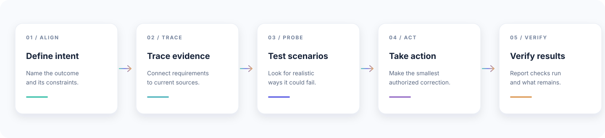

<h1 align="center">IntentWeft</h1>

  <strong>Keep project intent woven into every AI change.</strong> 
  A portable skill for Codex and Claude Code that connects project requirements to evidence, realistic failure scenarios, practical corrections, and honest verification.

  <a href="#quick-start">Quick start</a> ·
  <a href="#how-it-works">How it works</a> ·
  <a href="#use-it">Use it</a> ·
  <a href="docs/INSTALLATION.md">Installation guide</a>

  
  
  
  

  

> An AI change can look right while breaking a promise in a product brief, a decision record, or a neighboring component. IntentWeft helps the agent find that mismatch and show the evidence, trigger, consequence, correction, and check.

For example, a location app promises to keep precise coordinates on-device, but a new analytics event sends them to a server. IntentWeft traces the promise to the outgoing payload, describes when the issue occurs, suggests a focused correction, and says how to verify the request.

The name joins **intent** with **weft**: the thread that runs through a woven fabric.

## How it works

A useful review connects the original goal to evidence and to a decision someone can act on. IntentWeft keeps each step visible:

  

**Requirement → evidence → trigger → consequence → correction → verification**

## What you get

- **Four focused modes:** preflight, review, verify, and handoff.
- **Source-linked findings:** requirements, observed facts, inferences, and unknowns stay distinct.
- **Practical next steps:** each material finding names its trigger, impact, correction, and verification.
- **Honest results:** the report says what was inspected, which checks actually ran, and what remains unknown.
- **Optional report helpers:** a Markdown template, a structured JSON format, and a Python helper for file fingerprints and report consistency.
- **Portable packaging:** one skill source and a local installer for Codex, Claude Code, or both.

The bundled installer and helper scripts need no API key, server, or third-party Python package.

## Quick start

Clone the repository and install IntentWeft into a project for both agents:

~~~bash
git clone https://github.com/ufodia/intentweft.git
cd intentweft
python scripts/install.py --agent both --scope project --project "/absolute/path/to/your-project" --dry-run
python scripts/install.py --agent both --scope project --project "/absolute/path/to/your-project"
~~~

Python 3.10 or later is required for the installer and helper scripts. The skill can also be installed manually by copying the complete `skills/intentweft/` folder. The installer checks all destinations first and refuses to overwrite an existing skill.

To install for one agent, pass `--agent codex` or `--agent claude`. To install for your user account across projects:

~~~bash
python scripts/install.py --agent both --scope user
~~~

On Windows, quote project paths that contain spaces. See the [installation guide](docs/INSTALLATION.md) for supported locations, manual installation, updates, and compatibility notes.

## Use it

Invoke **`$intentweft`** in Codex or **`/intentweft`** in Claude Code, then describe the change and the project intent you want checked. For example:

~~~text
Review this change against the project requirements.
Trace each material finding to source evidence, give me the smallest practical fix,
and report only the checks that actually ran. Keep the review within this change.
~~~

Choose a mode when it helps:

| Mode | Use it for |
| --- | --- |
| **Preflight** | Check a proposed plan against requirements and likely failure paths before implementation. |
| **Review** | Compare code, documents, or a change set with the intended outcome. |
| **Verify** | Revisit a finding after a fix and collect fresh evidence for the affected behavior. |
| **Handoff** | Give another agent a source-linked state it can reconstruct. |

You can also ask it to resolve conflicting instructions, review whether supplied documents support a claim, or prepare a release decision. Small tasks can stay as a short inline review; a durable report is optional.

## What a finding looks like

~~~text
F1 — Analytics event includes precise coordinates
Requirement — product-brief.md, “Data promise”
Evidence — analytics.ts, outgoing latitude/longitude fields
Trigger — the event is sent with a device position
Impact — the payload conflicts with the documented storage promise
Correction — remove precise coordinates and inspect related event fields
Verification — inspect a captured outgoing event after the fix
Status — not run; static inspection does not establish production traffic
~~~

Read the complete [worked example](examples/location-privacy/REVIEW.md) or explore the [synthetic evaluation cases](evals/README.md).

## Optional evidence helper

For a durable JSON report, fingerprint only the files you selected:

~~~bash
python skills/intentweft/scripts/evidence.py snapshot --root /path/to/project --out sources.json product-brief.md src/analytics.ts
python skills/intentweft/scripts/evidence.py check report.json --root /path/to/project
~~~

The helper reads the named files without network requests and stores paths and hashes, not file contents. It can detect listed files that have changed and check report structure and cross-references. It does not prove that a claim is true, find unlisted changes, run project tests, or certify correctness. See the [report format](skills/intentweft/references/report-format.md).

## Scope and limits

IntentWeft follows the host's permissions, project instructions, and the user's requested scope. A review request does not authorize deployment or publication. It does not guarantee that every problem will be found or certify security, legal outcomes, or correctness.

**“Ready” means ready within the stated scope and evidence.** Missing evidence stays visible, verification is limited to checks that actually ran, and accepted risks require an explicit decision.

The core skill uses common Agent Skills frontmatter and relative resource links. This repository documents local installation for Codex and Claude Code; ChatGPT account-level skills, Claude.ai, and remote sessions may need different packaging.

## Development and evaluation

Run the repository checks locally:

~~~bash
python scripts/check_repository.py
python -m unittest discover -s tests -v
~~~

GitHub Actions runs these checks on Ubuntu, Windows, and macOS with Python 3.10, 3.12, and 3.15. They check packaging and helper behavior, not model review quality. The synthetic evaluation procedure and its limits are in [evals/README.md](evals/README.md); the recorded scope is in [eval results](evals/RESULTS.md).

See [contributing](CONTRIBUTING.md), [security reporting](SECURITY.md), and the [MIT license](LICENSE).

## Official format references

- [OpenAI: Build skills](https://learn.chatgpt.com/docs/build-skills)
- [Claude Code: Extend Claude with skills](https://code.claude.com/docs/en/skills)
- [Agent Skills specification](https://agentskills.io/specification)
